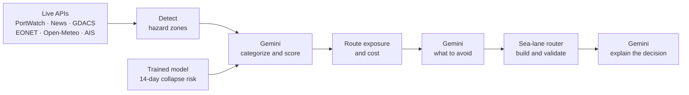
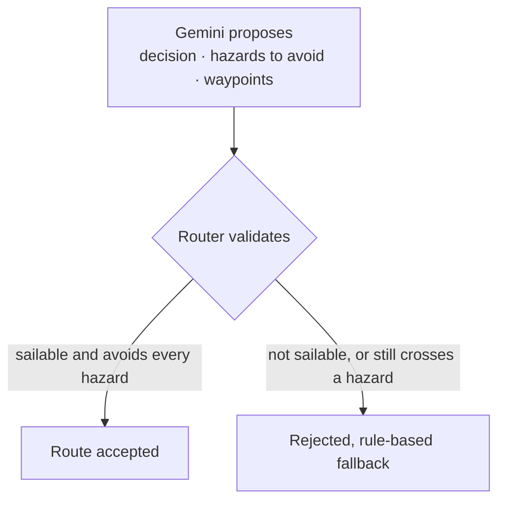
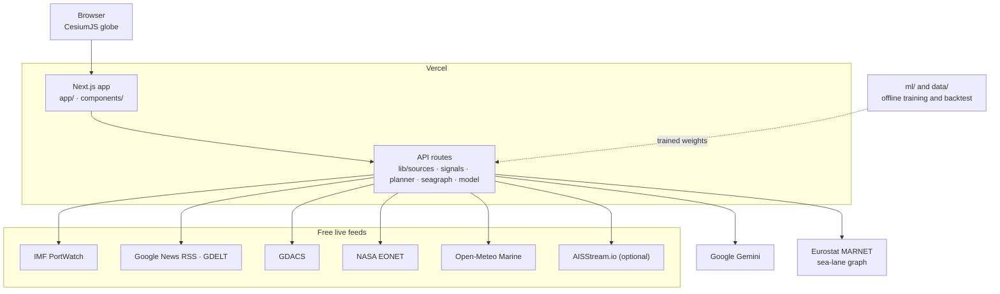

# Vantage

**Know what is on your shipping lane before your ship does.**

Live maritime risk intelligence for shipping companies. Vantage watches the world's sea lanes on a 3D globe, detects threats to a shipment from free live data, ranks them by what they cost *this* voyage, and replans a feasible, safer route with a plain-English explanation.

[Live demo](https://vantage-rust-alpha.vercel.app) · [Product](PRODUCT.md) · [Design](DESIGN.md) · [Model and backtest](ml/README.md) · [Results](ml/RESULTS.md) · [Data](data/README.md) · [Slides](https://www.canva.com/design/DAHXl5SCHxs/4idSz1iLht3JnAYa_57X_Q/edit)

[](https://nextjs.org)
[](https://www.typescriptlang.org)
[](https://cesium.com/platform/cesiumjs/)
[](https://aistudio.google.com)
[](ml/README.md)
[](https://vantage-rust-alpha.vercel.app)
[](#data-sources)
[](LICENSE)

<!-- Add a hero screenshot or GIF of the globe here:  -->

---

## The problem

A single closed chokepoint can add weeks and hundreds of thousands of dollars to a voyage. The signals that warn of it are scattered across the open web, and by the time a team has read them all, the ship has already sailed.

- **The signals are scattered.** Transit counts, security news, storm alerts and wave forecasts each live on a different site, in a different format.
- **Most of them are noise.** A headline about land fighting is not a threat to shipping. A human has to tell the difference, every time.
- **Risk is not the same for every voyage.** A hazard matters only if it sits near this route, on the day this ship gets there.
- **A warning is not a plan.** Knowing a zone is dangerous does not tell you which sailable route avoids it, or what the detour costs.

The data is free and public. What is missing is something that reads it, scores it against a specific voyage, and hands back a route.

## What Vantage does

| Step | What it means |
| --- | --- |
| **01 Detect** | Pulls live hazards from free feeds: chokepoint traffic, security news, cyclones, quakes, volcanoes, storms, icebergs and wave forecasts. |
| **02 Predict** | A trained, calibrated model estimates the chance a chokepoint's traffic collapses in the next 14 days. |
| **03 Categorize** | Gemini reads each zone's headlines and data and returns a category, severity, confidence and rationale. Land-only fighting is dismissed as a false alarm. |
| **04 Prioritize** | Each hazard is scored by urgency, business impact in USD, risk and confidence, against the actual route. |
| **05 Decide** | Proceed, sail to a checkpoint and reassess, or reroute. |
| **06 Explain** | Plain-English reasoning: why the original route is risky, why a backup is needed, and how it averts the risk. |

## How it works



1. **Detect** (`lib/sources.ts`, `lib/signals.ts`): IMF PortWatch chokepoint transits (7-day against a 90-day baseline), maritime-security news for 12 watch zones (Google News RSS, GDELT), GDACS cyclone, quake and volcano alerts, NASA EONET storms and icebergs, and Open-Meteo wave forecasts for the day the ship arrives.
2. **Categorize** (`lib/signals.ts`): Gemini reads each zone's headlines and traffic data and returns a category (armed conflict, piracy, military tension, congestion and so on), a severity, a confidence and a rationale. Commentary and land-only fighting are marked as not a threat to shipping, which keeps false alarms down.
3. **Prioritize** (`lib/planner.ts`): every hazard near the route gets an exposure (score × proximity, discounted for storms far ahead). Risk index, war-risk premium, voyage cost and expected disruption cost are computed per route.
4. **Replan** (`lib/planner.ts`, `lib/seagraph.ts`): Dijkstra on the Eurostat MARNET sea-lane network produces three routes: **original** (shortest), **safest** (blocks high-risk zones) and **balanced** (soft penalty). It also builds a **checkpoint plan**: sail the short route to a staging port before the first hazard, reassess with fresh data, then continue or divert. Gemini chooses the decision, the hazards to avoid and optional waypoints. The router builds that path and rejects it if it is not sailable or still crosses an avoided hazard.
5. **Explain**: Gemini writes the decision, the trade-offs and the reasoning using only computed numbers. Without an API key, rule-based reasoning fills in.

### The language model never gets the last word



Prioritization is computed, not generated: urgency × business impact in USD × risk × confidence. The model supplies reasoning text and route proposals, and the sea-lane router checks every proposal before it reaches the screen.

## The product

### A globe that shows the work

Vantage runs on a CesiumJS globe with selectable imagery (Esri Dark Gray, OpenStreetMap, Esri World Imagery). Watch zones, hazards, the original route and the backup route are drawn on it. The planner streams a visible **Detect, Predict, Categorize, Prioritize, Decide, Explain** pipeline so the reasoning is on screen as it happens.

<!--  -->

### Simulate a strike

Click anywhere on the globe to drop a missile strike on shipping and watch the plan change. It is the fastest way to see how the planner reacts to a new hazard.

### Confidence on every hazard

Each hazard carries a **confidence score (0 to 100%)** built from source agreement, data freshness, model and AI certainty, and a missing-data penalty, with a one-line reason.

### Honest about its data

The **Data sources** tab shows which feeds are live, which are running on a bundled last-good snapshot, and which are down. It also lists the signals that were dismissed as false alarms, and why.

### Live ships (optional)

With a free `AISSTREAM_API_KEY`, the server samples AISStream for a few seconds around the watch zones, draws ships on the globe, and flags congestion, speed drops, scattered courses and AIS gaps as anomalies that raise the zone's hazard score. Vercel functions cannot hold a socket open, so this is a short sample per request, not a persistent stream.

<!--  -->

## Trained prediction model, with proof

Beyond live signals, Vantage runs a **trained, calibrated model** that estimates the chance a chokepoint's traffic collapses within the next 14 days, plus a 7-day forecast with a prediction interval.

- Trained and backtested on **7.7 years** of IMF PortWatch transits plus weekly news volume.
- **Walk-forward** evaluation with no future leakage.
- Evaluated in TypeScript on Vercel. **No Python at runtime.**
- Compared against a naive rule and against the scoring the app shipped with before.

| 14-day horizon, 23 events | False-alarm rate | False alert episodes per chokepoint-year | Events warned before traffic fell | Median lead |
| --- | --- | --- | --- | --- |
| **Vantage** | **2.9%** | **0.95** | **11 / 23** | **+10 d** |
| Previous app scoring | 3.8% | 1.82 | 10 / 23 | +0.5 d |
| Naive drop > 15% | 6.4% | 2.83 | 10 / 23 | -1 d |

This is a modest, honestly measured gain on a rare-event problem, including where it did not help. In the Red Sea case the transit model alerted only as carriers reacted, while the news layer was four weeks earlier. That is why Vantage uses both.

Method, data, caveats and the Red Sea case study: [`ml/README.md`](ml/README.md), [`ml/RESULTS.md`](ml/RESULTS.md), [`data/README.md`](data/README.md). Charts are in [`slides/`](slides).

## Why this approach

- **Free data only.** Every signal comes from a public source, so anyone can run it without a data contract.
- **Computed first, generated second.** Risk, cost and priority are numbers. The language model explains them and proposes routes, and never invents them.
- **Every route is validated.** A proposed path must be sailable on the real sea-lane network and must avoid every hazard it claims to avoid, or it is rejected.
- **It degrades gracefully.** No Gemini key means rule-based reasoning. A feed goes down and the app uses its last-good snapshot and says so.
- **It reports where it fails.** The backtest includes the cases the model got wrong.

## Architecture



| Path | What it is |
| --- | --- |
| `app/` | Next.js routes and API handlers. |
| `components/` | The globe, the planner panel and the data-sources tab. |
| `lib/` | Detection, categorization, route planning, the sea-lane graph and the model runtime. |
| `ml/` | Training and backtest code, written in Python. See [`ml/README.md`](ml/README.md). |
| `data/` | Training data and its documentation. |
| `scripts/` | Build scripts, including `build-searoute-graph.mjs`. |
| `slides/` | Charts and slides from the backtest. |
| `public/` | Static assets. |

## Quick start

You need Node.js and npm. A free [Gemini API key](https://aistudio.google.com/apikey) is recommended, and a free [AISStream key](https://aisstream.io) is optional.

```bash
cp .env.example .env.local   # add GEMINI_API_KEY and, optionally, AISSTREAM_API_KEY
npm install
npm run dev
```

Open <http://localhost:3000>.

**Checks**

```bash
npx eslint .
npx tsc --noEmit
npm run build
npx tsx lib/model.test.ts    # Python and TypeScript parity
```

**Retrain and re-run the backtest**

```bash
pip install -r ml/requirements.txt
python ml/run_all.py --skip-news
```

## Configuration

| Variable | Required | Where to get it |
| --- | --- | --- |
| `GEMINI_API_KEY` | Recommended. The app falls back to rule-based reasoning without it. | <https://aistudio.google.com/apikey> |
| `AISSTREAM_API_KEY` | Optional. No live ships or AIS anomalies without it. | <https://aisstream.io> (free) |
| `GEMINI_MODEL` | Optional. Overrides the default model order. | n/a |

## Deploy

Push to GitHub and import the repo into Vercel. Set the variables above for **Production and Preview** (Project, Settings, Environment Variables).

Turn off Deployment Protection for Production so the public link opens logged out (Settings, Deployment Protection).

## Data sources

All of them are free.

| Signal | Source |
| --- | --- |
| Chokepoint transits (live and training) | IMF PortWatch (ArcGIS REST) |
| Conflict, piracy, military news | Google News RSS, GDELT 2.0 DOC API |
| Cyclones, earthquakes, volcanoes | GDACS |
| Storms, icebergs | NASA EONET |
| Wave forecast | Open-Meteo Marine |
| Live ships (optional) | AISStream.io |
| Sea-lane network | Eurostat MARNET via searoute-js, built by `scripts/build-searoute-graph.mjs` |
| Globe imagery | Esri Dark Gray, OpenStreetMap, Esri World Imagery |
| Reasoning | Google Gemini (free tier) |

## Docs

| File | What it covers |
| --- | --- |
| [`PRODUCT.md`](PRODUCT.md) | What the product does, and for whom. |
| [`DESIGN.md`](DESIGN.md) | The design language. |
| [`ml/README.md`](ml/README.md) | Model method, features and evaluation. |
| [`ml/RESULTS.md`](ml/RESULTS.md) | Backtest results and the Red Sea case study. |
| [`data/README.md`](data/README.md) | Datasets and how they were built. |
| [`AGENTS.md`](AGENTS.md), [`CLAUDE.md`](CLAUDE.md) | Guidance for coding agents working in this repo. |

## Limitations

- The prediction model is evaluated on 23 events. That is enough to show a direction, not to claim a guarantee.
- Live AIS is a short sample per request, not a continuous feed.
- Route planning is limited to the MARNET sea-lane network, so very local navigation is out of scope.
- News-based signals depend on what the free feeds publish and when.

## License

Add a license here, for example MIT.